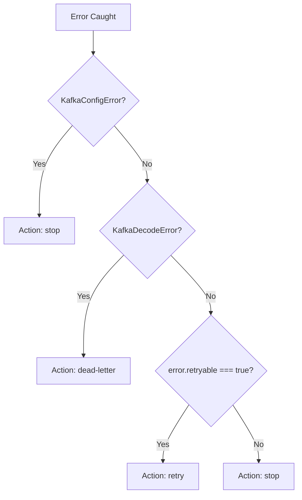

# Architecture & System Design — @oneunit/kafka

**Status:** Beta (v1.1.0-beta.0)  
**Package:** `@oneunit/kafka`  
**Target Runtime:** Node.js `>= 20.0.0` (ESM native, `"type": "module"`)  
**Underlying Driver:** `kafkajs@2.2.4`  

---

## 1. Executive Summary & Design Principles

`@oneunit/kafka` is an enterprise-grade, high-reliability Apache Kafka client library for Node.js. It encapsulates [KafkaJS](https://kafka.js.org/) inside an architecturally sound runtime that addresses the real-world operational challenges of distributed messaging in Node.js: race conditions during reconnection, unsafe offset commits under concurrent async processing, uncoordinated consumer pausing, resource leaks during shutdown, and configuration errors.

The codebase is engineered around **five core architectural principles**:

```
┌─────────────────────────────────────────────────────────────────────────────┐
│                            DESIGN PRINCIPLES                                │
├─────────────────────────────────────────────────────────────────────────────┤
│ 1. Default API First        │ Minimal ceremony for standard workflows       │
│ 2. Explicit Resource Ownership│ Named, tracked slots with clear lifecycle   │
│ 3. Resilient Runtime Core   │ Epoch guards, promise deduplication, rollback │
│ 4. Composable Capabilities  │ Onion middleware, modular plugins, codecs     │
│ 5. Strict Layered Boundary  │ Isolated KafkaJS driver with raw escape hatch │
└─────────────────────────────────────────────────────────────────────────────┘
```

1. **Default API First**: Standard pub/sub operations require zero boilerplate (`Kafka.create()`, `publish()`, `subscribe()`). Complex resource management (connections, runners, registries) occurs lazily behind the facade.
2. **Explicit Resource Ownership**: Producers, consumers, and admin clients are allocated into named, deterministic resource slots. Nothing connects invisibly; every socket is registered and tracked.
3. **Resilient Runtime Core**: In-flight connection attempts are deduplicated through cached promises. Reconnection races are eliminated using generation/epoch guards that discard stale connections created prior to a disconnect.
4. **Composable Capabilities**: Features such as middleware, plugins, retry policies, dead-letter routing, RPC, transactions, and metrics are modular layers that wrap the core without modifying the transport adapter.
5. **Strict Layered Boundary with Escape Hatch**: KafkaJS-specific classes and types never leak into the public facade. However, for legacy systems or custom protocol needs, `kafka.raw` provides a direct escape hatch to the underlying KafkaJS instances while retaining managed teardown on shutdown.

---

## 2. Five-Tier System Architecture

The codebase strictly enforces a unidirectional dependency hierarchy. Higher layers may import from lower layers; lower layers **never** import from higher layers.

```mermaid
graph TD
    classDef l1 fill:#1e3a8a,stroke:#3b82f6,stroke-width:2px,color:#fff;
    classDef l2 fill:#065f46,stroke:#10b981,stroke-width:2px,color:#fff;
    classDef l3 fill:#78350f,stroke:#f59e0b,stroke-width:2px,color:#fff;
    classDef l4 fill:#4c1d95,stroke:#8b5cf6,stroke-width:2px,color:#fff;
    classDef l5 fill:#374151,stroke:#9ca3af,stroke-width:2px,color:#fff;

    subgraph Layer1 ["Tier 1: Public Facade (src/public/)"]
        KafkaApp["KafkaApplication<Topics>"]:::l1
        KafkaNamespace["Kafka Namespace (Kafka.create)"]:::l1
        LegacyAdapter["Legacy Options Adapter"]:::l1
    end

    subgraph Layer2 ["Tier 2: Capability Subsystems"]
        ConsumerEng["Consumer Engine (src/consumer/)"]:::l2
        ProducerBatch["Producer & Batching (src/producer/)"]:::l2
        ResilienceSub["Resilience & DLQ (src/resilience/)"]:::l2
        RpcSub["RPC Subsystem (src/rpc/)"]:::l2
        MiddlewareSub["Onion Middleware (src/middleware/)"]:::l2
        PluginSub["Plugin System (src/plugins/)"]:::l2
        ObservabilitySub["Observability & Tracing (src/observability/)"]:::l2
        AdminSub["Cluster Admin (src/admin/)"]:::l2
        SchemaSub["Schema Registry & Codecs (src/schema/)"]:::l2
        SecuritySub["Security (SASL & TLS) (src/security/)"]:::l2
    end

    subgraph Layer3 ["Tier 3: Runtime Core (src/core/)"]
        KafkaClient["KafkaClient Runtime"]:::l3
        ResourceSlot["ResourceSlot (Promise Deduplication & Epoch Guard)"]:::l3
        ResourceReg["ResourceRegistry & ResourceManager"]:::l3
        StateMachine["StateMachine & Lifecycle Transitions"]:::l3
        ShutdownCoord["Shutdown Coordinator"]:::l3
    end

    subgraph Layer4 ["Tier 4: Transport Adapters (src/transport/kafkajs/, src/adapters/)"]
        ConfigMapper["Config Mapper & Validator"]:::l4
        LoggerAdapter["Logger Adapter (Pino/Winston Bridge)"]:::l4
        DriverFactories["KafkaJS Factories (Producer, Consumer, Admin)"]:::l4
    end

    subgraph Layer5 ["Tier 5: External Driver & Network"]
        KafkaJSDriver["KafkaJS Driver (kafkajs)"]:::l5
        Brokers["Apache Kafka Cluster / Brokers"]:::l5
    end

    Layer1 --> Layer2
    Layer2 --> Layer3
    Layer3 --> Layer4
    Layer4 --> Layer5
```



### Dependency Rules

| Tier | Directory | Permitted Dependencies | Forbidden Dependencies |
|---|---|---|---|
| **Tier 1: Public Facade** | `src/public/` | Tiers 2, 3, 4, Utils, Errors | None |
| **Tier 2: Capabilities** | `src/consumer/`, `src/producer/`, `src/rpc/`, etc. | Tiers 3, 4, Utils, Errors | Tier 1 (`src/public/`) |
| **Tier 3: Runtime Core** | `src/core/` | Tier 4, Utils, Errors | Tiers 1, 2 |
| **Tier 4: Transport Adapters** | `src/transport/kafkajs/`, `src/adapters/` | KafkaJS, Utils, Errors | Tiers 1, 2, 3 |
| **Tier 5: External Driver** | `node_modules/kafkajs` | External network | All application code |

---

## 3. Detailed Component Breakdown

### 3.1 Public Application Facade (`src/public/application.ts`)

`KafkaApplication<Topics>` serves as the unified entry point for application developers. It coordinates lazy resource allocation, middleware execution, plugin dispatch, and lifecycle termination.

#### Key Responsibilities
- **Topic Type Binding**: Accepts a generic `Topics = Record<string, unknown>` to enforce type-checked message values on `publish`, `publishMany`, and `subscribe`.
- **Resource Slot Coordination**: Manages maps of `producerSlots`, `consumerSlots`, and `adminSlots`.
- **Fail-Fast Configuration Validation**: The private `validate()` method runs synchronously during instantiation before any network socket is opened. It validates:
  - `brokers`: Required, non-empty list of non-whitespace strings.
  - Non-negative timeouts: `connectionTimeout`, `requestTimeout`, `authenticationTimeout`.
  - Supported SASL mechanisms: `plain`, `scram-sha-256`, `scram-sha-512`, `aws`, `oauthbearer`.
  - Mutual TLS requirement: `oauthbearer` strictly requires TLS (`ssl`) to be configured.
  - Incompatible producer settings: `producer.idempotent` cannot be combined with `producer.transactionalId`; `producer.idempotent` requires `producer.acks = "all"`.
  - Consumer group ID: `groupId` cannot be blank when consumer configuration is present.
  - Strict key whitelist: Rejects unknown package-level keys while permitting KafkaJS pass-through under `kafkaJS`.
- **Execution Pipeline**: `publish` and `publishMany` wrap the client transport in the `composePublish` onion pipeline; `subscribe` wraps user handlers in the `composeConsume` onion pipeline.
- **Escape Hatch (`raw`)**: Provides getters for `raw.producer(name)`, `raw.consumer(name)`, and `raw.admin()`, returning the underlying KafkaJS instances while keeping ownership of their cleanup.

---

### 3.2 Consumer Engine (`src/consumer/consumer.ts`)

The consumer engine (`KafkaConsumer<T>`) replaces naive `eachMessage` loops with a production-grade consumer runner designed for high concurrency and zero message loss.

```
Incoming KafkaJS Batch
         │
         ▼
┌────────────────────────────────────────────────────────┐
│ Concurrency Limiter (maxInFlight Semaphore)           │
└────────────────────────┬───────────────────────────────┘
                         │ Wait if inFlight >= maxInFlight
                         ▼
┌────────────────────────────────────────────────────────┐
│ Multi-Reason Pause Guard (pauseReasons.size === 0)     │
└────────────────────────┬───────────────────────────────┘
                         │
                         ▼
┌────────────────────────────────────────────────────────┐
│ Context Enrichment & AbortSignal Wiring                │
└────────────────────────┬───────────────────────────────┘
                         │
                         ▼
┌────────────────────────────────────────────────────────┐
│ Consume Middleware Pipeline (composeConsume)           │
└────────────────────────┬───────────────────────────────┘
                         │
        ┌────────────────┴────────────────┐
        ▼ Success                         ▼ Failure
┌───────────────────────────────┐ ┌───────────────────────────────┐
│ Contiguous Offset Tracker     │ │ Retry Policy Classifier       │
│ - Record completed offset     │ ├──────────────┬────────────────┤
│ - Safe contiguous commit      │ │ "retry"      │ Backoff retry  │
└───────────────────────────────┘ │ "dead-letter"│ Publish to DLQ │
                                  │ "stop"       │ Rethrow/Halt   │
                                  └──────────────┴────────────────┘
```

#### Core Mechanisms
1. **Managed Runner**: Allocates a single KafkaJS `Consumer` per consumer group, supporting multiple registered topic subscriptions under one runner.
2. **Backpressure Semaphore (`maxInFlight`)**: Bounded concurrency across partitions. When active executions reach `maxInFlight` (default 100), incoming messages queue in `inFlightWaiters` until a slot is released.
3. **Contiguous Offset Tracking**:
   - Maintains `observedOffsetSets` and `completedOffsetSets` per partition.
   - Computes the highest contiguous completed offset. If offsets `[100, 102, 103]` complete while offset `[101]` is still running, only `100` is committed. When `101` completes, the committed offset immediately advances to `103`.
4. **Multi-Reason Reference-Counted Pausing**: Pauses are tracked in a `Set<string>`. Calling `consumer.pause("rate-limit")` and `consumer.pause("circuit-breaker")` adds both reasons. The consumer only resumes transport intake when `consumer.resume()` has cleared every reason.
5. **AbortSignal Integration**: Every `MessageContext` receives an `AbortSignal` that triggers if the consumer runner stops or shuts down while the handler is executing.
6. **Per-Handler Timeout (`handlerTimeoutMs`)**: Each consumer handler is optionally bounded by `handlerTimeoutMs` (set via `KafkaConsumerOptions`). If a handler exceeds this limit, its `AbortSignal` is aborted and the promise rejects with `KafkaTimeoutError`. The semaphore slot is released immediately so `awaitInFlight` during shutdown cannot block indefinitely on a deadlocked handler.

---

### 3.3 Producer & High-Throughput Batching (`src/producer/`)

The producer subsystem offers two distinct paths: immediate direct publishing and buffered batching.

#### Immediate Publish (`KafkaApplication.publish`)
Routes payloads through `composePublish` middleware, resolves per-call or application-level codecs, runs validation, and forwards to `producer.send()`.

#### Buffered Batch Producer (`BufferedBatchProducer` in `src/producer/batch.ts`)
Accumulates records in-memory across topics and dispatches batched publishes based on configurable thresholds:
- **Triggers**:
  - `maxRecordsPerTopic`: Flush a topic when its buffer reaches this count (default 1,000).
  - `maxBufferedRecords`: Flush all topics when total buffer hits this count (default 10,000).
  - `maxBufferedBytes`: Flush when total buffer bytes reach this threshold (default 1 MB).
  - `flushIntervalMs`: Flush at least once every interval (default 5,000ms).
- **Backpressure & Rejection**:
  - Rejects `send()` with `KafkaConnectionError` when `maxQueuedRecords` (default 50,000) or `maxQueuedBytes` (default 50 MB) are exceeded.
- **Drain on Teardown**: `close()` flushes pending buffers before disconnecting the producer. Any records still pending after teardown are rejected cleanly.

#### Transaction Coordinator (`src/producer/transaction.ts`)
Encapsulates Kafka transactions via `runTransaction`:
```ts
runTransaction(kafka, async (tx) => {
  await tx.publish("orders", order);
  await tx.publish("events", event);
  // Returns result on automatic commit
});
```
- Manages `TransactionalProducer` lifecycle with auto-generated unique `transactionalId`.
- Automatically calls `commit()` if callback resolves; automatically calls `abort()` if callback throws.
- Captures and preserves both primary and abort errors using `Error.cause`.

---

### 3.4 Resilience & Fault Tolerance Subsystem (`src/resilience/`)

#### Retry Engine (`retry.ts`)
Calculates exponential backoff with uniform random jitter:

$$delay = \min(maxDelayMs, baseDelayMs \times 2^{attempt}) \times (1 + \text{random}(0, 0.2))$$

- `maxAttempts`: Default 8.
- `maxElapsedTimeMs`: Default 300,000ms (5 minutes).
- `baseDelayMs`: Default 100ms.
- `maxDelayMs`: Default 30,000ms (30 seconds).

#### Classification Tree (`defaultClassifier`)


#### Dead-Letter Queue Publisher (`dead-letter.ts`)
- Wraps failed message payloads into a standardized `DeadLetterRecord` containing: `originalTopic`, `originalPartition`, `originalOffset`, `originalKey`, `originalPayload`, `originalHeaders`, `failureTimestamp`, `attemptCount`, `errorName`, `errorMessage`, `consumerGroup`, `correlationId`, `messageId`.
- Retries DLQ publication up to 3 times.
- If DLQ publication fails, the error is rethrown and the original offset is **not** committed.

---

### 3.5 RPC Subsystem (`src/rpc/`)

Implements asynchronous request-response semantics over standard Kafka topics:
- **`RpcClient` (`rpc/client.ts`)**:
  - Generates a UUID v4 correlation ID.
  - Appends `correlation-id` and response topic into outgoing message headers.
  - Registers a pending resolver in `pending = Map<correlationId, PendingRequest>`.
  - Sets a per-request timer; upon expiration, evicts the entry and rejects with `KafkaTimeoutError`.
  - Response consumer listens on `${requestTopic}.responses` (or custom topic) and resolves the matching promise.
- **`RpcServer` (`rpc/server.ts`)**:
  - Subscribes to the request topic.
  - Executes user handler and publishes the result to the response topic with the inbound correlation ID.
  - Captures errors thrown by handlers and returns an envelope with an `error: { name, message }` payload.

---

### 3.6 Onion Middleware Subsystem (`src/middleware/`)

Implements Koa-style inverted onion pipeline composition for four distinct execution boundaries:
1. `PublishMiddleware<T>`: Intercepts `publish` and `publishMany`.
2. `ConsumeMiddleware<T>`: Intercepts message consumption.
3. `ErrorMiddleware`: Intercepts pipeline errors.
4. `AdminMiddleware`: Intercepts administrative cluster operations.

#### Pipeline Invariant: Single `next()` Invocation
```ts
export function composePublish<T>(middleware: PublishMiddleware<T>[], transport: (ctx: PublishContext<T>) => Promise<unknown>) {
  return function (context: PublishContext<T>): Promise<unknown> {
    let index = -1;
    function dispatch(i: number): Promise<unknown> {
      if (i <= index) return Promise.reject(new Error("next() called multiple times"));
      index = i;
      const fn = middleware[i];
      if (i === middleware.length) return transport(context);
      return Promise.resolve(fn(context, () => dispatch(i + 1)));
    }
    return dispatch(0);
  };
}
```

---

### 3.7 Plugin Subsystem (`src/plugins/`)

Provides a modular extension model with transactional rollback guarantees:
- **`KafkaPlugin`**: Defines `name`, `install(context)`, optional `onReady()`, and optional `onClose()`.
- **`PluginManager` (`plugins/manager.ts`)**:
  - Installs plugins in declaration order.
  - Duplicate names throw `KafkaPluginError`.
  - **Transactional Rollback**: `wrapContext()` intercepts all registrations (`registerPublishMiddleware`, `registerCodec`, `registerHealthCheck`, etc.) made by a plugin. If `plugin.install()` fails, all registered callbacks for that plugin are immediately executed in reverse order.
  - **Reverse Teardown**: During shutdown, plugin `onClose` hooks run in **reverse order of installation**. One plugin failure does not halt others.
  - **Timeout Protection**: `onReady` and `onClose` executions are wrapped with a timeout (default 10s).

---

### 3.8 Observability & Distributed Tracing (`src/observability/`)

#### 1. In-Memory Metrics Collector (`metrics.ts`)
- Implements `increment`, `gauge`, and `timing`.
- **Cardinality Bounding**: Implements `MAX_LABEL_SETS_PER_METRIC = 100`. When unique label sets for a metric exceed 100, new label dimensions are rejected to eliminate unbounded memory growth.
- **Consumer Lag Tracking**: Calculates consumer lag per topic and partition as $\text{high-watermark} - \text{highest contiguous completed offset}$.

#### 2. Health Reporter (`health.ts`)
- **Liveness**: Returns `alive: true` if the application instance has not initiated shutdown.
- **Readiness**: Evaluates broker connectivity, application state, and custom health checks registered by plugins.

#### 3. Distributed Tracing (`tracing.ts`)
- Implements W3C `traceparent` and `tracestate` header injection and extraction.
- Lazily binds to OpenTelemetry (`@opentelemetry/api`) if available; falls back to `noopTracer()` without requiring hard dependencies.
- Auto-registers `tracingMiddleware` and `consumeTracingMiddleware` when tracing is configured.

---

### 3.9 Security Subsystem (`src/security/`)

#### SASL Configuration (`sasl.ts`)
- Supports `plain`, `scram-sha-256`, `scram-sha-512`, `aws`, and `oauthbearer`.
- Validates supported mechanisms up-front, throwing `KafkaConfigError` with clear diagnostics.
- Supports dynamic `OAuthTokenProvider` callbacks for token renewal.
- Enforces TLS requirement: `oauthbearer` mechanism requires TLS to be enabled.

#### TLS/SSL Configuration (`ssl.ts`)
- Automatically detects whether certificate inputs (`ca`, `cert`, `key`) are inline PEM strings or filesystem paths.
- Uses `fs.statSync` to verify certificate files exist and are regular files, avoiding cryptic Node.js stream errors.
- Coerces `rejectUnauthorized` safely (ensuring string `"false"` correctly resolves to boolean `false`).

#### Secret Redaction (`KafkaError.redact`)
- Sanitizes sensitive parameters (passwords, tokens, keys) in error messages: values are masked to `[redacted]` or `pa***`.

---

### 3.10 Serialization & Schema Registry (`src/schema/`, `src/messaging/`)

#### Synchronous Codec Contract
The `Codec` interface is explicitly synchronous:
```ts
export interface Codec {
  name: string;
  encode(value: unknown): Buffer | string | null | undefined;
  decode(bytes: unknown): unknown;
}
```
> [!NOTE]
> Synchronous codecs eliminate race conditions and unnecessary microtask queue scheduling during high-throughput produce loops. Built-in codecs include `jsonCodec` (default) and `bytesCodec`.

#### Schema Registry Implementations (`schema/types.ts`)
1. `InMemorySchemaRegistry`: In-process registry with LRU-style cache bounds (`maxCacheSize`), schema identity hashing, and compatibility checking. Ideal for testing.
2. `AbstractSchemaRegistry`: Base class providing wire-format encoding, 2-byte length-prefixed schema ID framing, caching, and error normalization.
3. `ConfluentSchemaRegistry`: Production HTTP client for Confluent Schema Registry with basic auth, bearer token auth, and schema resolution caching.

---

### 3.11 Runtime Core & Resource Slot Management (`src/core/`)

The runtime core coordinates connections and resource state:

```
getProducer("orders")
         │
         ▼
┌────────────────────────────────────────────────────────┐
│ ResourceSlot Check                                     │
├────────────────────────────────────────────────────────┤
│ 1. Value exists?          ───> Return cached producer  │
│ 2. Pending promise exists?───> Return pending promise  │
│ 3. Allocate new promise   ───> Run factory with epoch  │
└────────────────────────┬───────────────────────────────┘
                         │
                         ▼
┌────────────────────────────────────────────────────────┐
│ Factory Resolves                                       │
├────────────────────────────────────────────────────────┤
│ Check: slot.generation === currentGeneration?          │
│   ├── YES: Store value, return producer                │
│   └── NO:  Stale connection! Disconnect & throw error  │
└────────────────────────┬───────────────────────────────┘
                         │
                         ▼
```

#### Stale Connection Epoch Guard (`ResourceSlot<T>` in `core/resource-slot.ts`)
When `disconnect()` or `close()` is called while an asynchronous connection attempt is in-flight:
1. `ResourceSlot.generation` is incremented.
2. When the pending connection attempt resolves, its generation is compared against `slot.generation`.
3. If generations do not match, the newly created socket is immediately destroyed (`shutdownClient`), and the caller receives `KafkaConnectionError("Kafka client was disconnected while it was connecting")`.
4. This completely eliminates stale-adoption bugs where a lingering connection is adopted by a shutdown client.

---

### 3.12 Transport Adapters (`src/transport/kafkajs/`, `src/adapters/`)

Transport adapters are the boundary between `@oneunit/kafka`'s abstraction layer and KafkaJS. They never leak KafkaJS types into the public facade.

#### Config Mapper (`src/transport/kafkajs/config-mapper.ts`)
Maps high-level `@oneunit/kafka` configuration into KafkaJS-specific options. Validates SASL mechanisms, TLS requirements, partitioner resolution, and timeout coercion. Produces KafkaJS-ready configuration objects for producers, consumers, and admin clients.

#### Logger Adapter (`src/transport/kafkajs/logger.js`)
Pino/Winston-compatible logger bridge. Provides `createLogger`, `resolveLoggerAndOptions`, `isLogger`, `silentLogger`, and `consoleLogger`. Supports custom logger implementations via structural typing (duck typing on `info`, `warn`, `error`, `debug` methods).

#### Driver Factories (`src/transport/kafkajs/factory.js`)
Creates and connects KafkaJS resources with consistent error handling:
- **`createProducer`**: Connects a KafkaJS `Producer` with partitioner resolution and producer-specific options.
- **`createConsumer`**: Connects a KafkaJS `Consumer` with group ID validation and consumer-specific options.
- **`createAdmin`**: Connects a KafkaJS `Admin` client with admin-specific options.
- **`connectKafkaResource`**: Consolidated helper that wraps resource creation, connection, and error-wrap/disconnect-on-failure logic into a single function. Eliminated ~30 lines of duplicated try/catch error handling across producer, consumer, and admin factory functions.

```
connectKafkaResource(create, connect, disconnect, logger, resourceName)
         │
         ▼
┌────────────────────────────────────────────────────────┐
│ 1. Create resource via factory function                │
│ 2. Log resource creation                               │
│ 3. Connect resource                                    │
│ 4. Log successful connection                           │
│ 5. Return connected resource                           │
│                                                        │
│ On connection failure:                                 │
│  - Log error                                           │
│  - Attempt best-effort disconnect                      │
│  - Throw KafkaConnectionError with original cause      │
└────────────────────────────────────────────────────────┘
```

---


## 4. Key Architectural Design Patterns

### Pattern 1: In-Flight Promise Deduplication
Concurrent callers requesting the same named resource (e.g., three services calling `kafka.producer("analytics")` during bootstrap) share a single underlying connection attempt. The promise is cached in `ResourceSlot.pending` and cleared upon resolution or rejection.

### Pattern 2: Contiguous Partition Offset Commitment
To prevent data loss when processing messages concurrently, the consumer maintains a bitmap of completed offsets. Only the contiguous completed range is committed to the broker.

### Pattern 3: Reference-Counted Multi-Reason Pause
Consumers maintain a `Set<string>` of active pause reasons. Independent subsystems (e.g. rate limiter and DB health checker) can pause and resume the consumer without clobbering each other's state.

### Pattern 4: Bidirectional Onion Middleware
Middleware wraps operations symmetrically. Pre-processing runs on the inbound pass; post-processing runs on the unwind pass. Double execution of `next()` is strictly guarded.

### Pattern 5: Transactional Plugin Install with Rollback
Every registration function exposed to `KafkaPlugin.install()` returns an unregister function. If any plugin throws during installation, all previously registered artifacts from that plugin are undone in reverse order.

### Pattern 6: Dual Facade Migration Bridge
The modern `KafkaApplication` facade and the legacy `KafkaClient` runtime share the same underlying `src/transport/kafkajs/` adapter. `createApplicationFromLegacyOptions()` allows legacy configurations to adopt the new architecture with zero downtime.

### Pattern 7: Layered Escape Hatch
`kafka.raw` provides direct access to the KafkaJS `Producer`, `Consumer`, and `Admin` instances for advanced edge-cases, while retaining central ownership of connection cleanup on shutdown.

### Pattern 8: Bounded Label Cardinality in Metrics
To prevent memory exhaustion from high-cardinality user labels, `InMemoryMetricsCollector` enforces a hard cap (`MAX_LABEL_SETS_PER_METRIC = 100`) per metric name.

---

## 5. Ten-Step Graceful Shutdown Sequence

Calling `await kafka.close()` executes a deterministic 10-step graceful teardown wrapped in safety guards:

```mermaid
sequenceDiagram
    autonumber
    actor App as Application / OS Signal
    participant Facade as KafkaApplication
    participant Consumers as KafkaConsumer Runners
    participant Producers as Producers & Batches
    participant Admin as KafkaAdmin Client
    participant Plugins as PluginManager
    participant Transport as KafkaJS Transport & Sockets

    App->>Facade: close()
    Note over Facade: Step 1: Set closed=true; record shutdownStartTime; reject new operations
    Facade->>Consumers: Step 2: stop() intake (halt intake loop, keep sockets open)
    Facade->>Consumers: Step 3: awaitInFlight(gracefulTimeout) (await active handlers)
    Facade->>Consumers: Step 4: commitOffsets() (commit contiguous completed offsets)
    Facade->>Producers: Step 5: flush() pending batches & disconnect producer clients
    Facade->>Consumers: Step 6: close() consumer transport sockets
    Facade->>Admin: Step 7: disconnect() admin client
    Facade->>Plugins: Step 8: Execute onClose hooks in reverse declaration order
    Facade->>Transport: Step 9: Disconnect remaining KafkaJS clients (bump generations)
    Note over Facade: Step 10: Record shutdown duration metric; clear resource registry
    Facade-->>App: Shutdown complete
```

### Safety Isolation
Every step in the shutdown sequence is wrapped in `KafkaApplication.safe(promise)`. If an individual consumer or admin client fails to disconnect or times out, the sequence logs the failure and continues executing subsequent steps, guaranteeing that the Node.js process can exit cleanly.

---

## 6. Error Taxonomy & Metadata Architecture

All package exceptions derive from `KafkaError` and carry structured debugging metadata:

```
KafkaError (base class, redact helper)
├── KafkaConfigError (invalid broker list, illegal SASL/TLS combination)
├── KafkaConnectionError (broker unreachable, connection stale / disconnected)
├── KafkaDecodeError (malformed JSON or corrupted codec bytes)
├── KafkaLifecycleError (illegal state transition, operation on closed resource)
├── KafkaProducerError (broker publish rejection, leader unavailable)
├── KafkaConsumerError (consumer runner failure)
├── KafkaValidationError (Zod / validator schema mismatch)
├── KafkaTransactionError (transaction aborted or committed twice)
├── KafkaTimeoutError (RPC timeout, in-flight handler timeout)
├── KafkaPluginError (duplicate plugin, hook failure)
└── KafkaSchemaRegistryError (remote schema resolution failure)
```

### Standard Error Properties
- `code: string`: Stable error code (e.g. `KAFKA_CONFIG_ERROR`).
- `operation: string`: The method or operation that failed (e.g. `publish`, `validate`).
- `topic?: string`: The topic involved in the failure.
- `resource?: string`: The name of the resource involved (e.g. `producer:orders`).
- `path?: string`: The configuration path that failed validation (e.g. `sasl.mechanism`).
- `retryable: boolean`: Whether the operation can be safely retried.
- `cause?: unknown`: The underlying error (preserved via native `Error.cause`).

---

## 7. Contributor Onboarding & Invariant Rules

When contributing to `@oneunit/kafka`, you must preserve the following architectural invariants:

1. **No Circular Dependencies**: Lower tiers must never import higher tiers. Specifically, `src/transport/` and `src/core/` must never import `src/public/`.
2. **Synchronous Codecs**: The `Codec` contract must remain synchronous. Asynchronous serialization causes uncoordinated microtask delays in the hot publish path.
3. **No Direct Driver Leakage**: Public facade methods must never expose KafkaJS types directly. Return package-owned types or use the explicit `raw` escape hatch.
4. **Idempotent Teardown**: Every `close()` and `disconnect()` method must be idempotent. Calling `close()` multiple times must return the same promise and never throw.
5. **Epoch Protection on Connect**: Any async resource instantiation must record its generation before awaiting and verify its generation before caching the resolved resource.
6. **Contiguous Commits Only**: Never commit raw offsets directly in concurrent consumer handlers. Always route through the contiguous offset tracker.
7. **Redact Sensitive Information**: Never include raw passwords, tokens, or certificate keys in error messages, logger bindings, or diagnostics snapshots. Always pass them through `KafkaError.redact()`.

### Verification Suite
Before submitting changes, run the full verification pipeline:
```bash
npm run verify
```
This runs TypeScript checking (`npm run typecheck`), type test verification (`npm run typecheck:types`), unit tests (`npm test`), and package packaging validation (`npm run pack:verify`).
